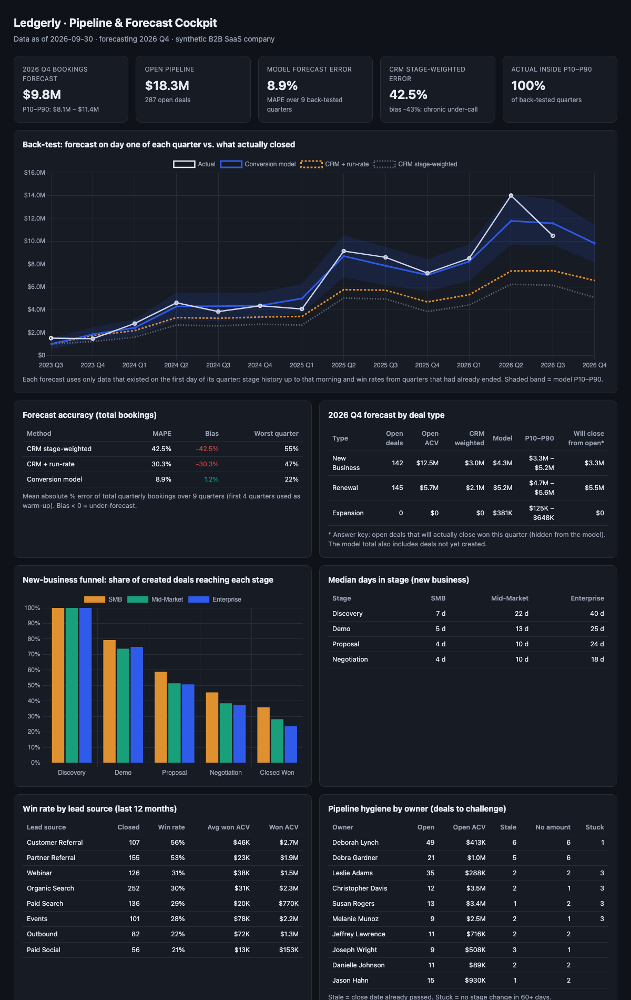
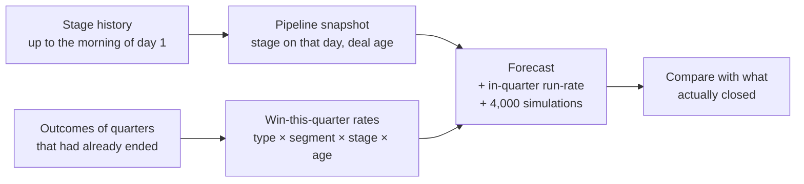

# Pipeline & Forecast Cockpit

**Pipeline analytics plus a quarterly bookings forecast that is back-tested honestly: for every past quarter it rebuilds the pipeline as it looked on day one, forecasts, and compares with what actually closed.**



Built on [ledgerly-data](https://github.com/jungmarker/ledgerly-data) (synthetic B2B SaaS CRM with full opportunity stage history).

## The result

| Method | Forecast error (MAPE, 9 quarters) | Bias |
|---|---|---|
| CRM stage-weighted (amount × stage %) | 42.5% | −42.5% |
| CRM + in-quarter run-rate | 30.3% | −30.3% |
| **Conversion model** | **8.9%** | **+1.2%** |

On a second simulated company that was never used while building the model, the conversion model scores **8.1%** MAPE, against 38.1% for CRM weighting. Actual bookings fell inside the model's P10–P90 range in every back-tested quarter (an 80% interval covering 100% suggests the band is a bit conservative).

**Why the usual CRM number under-calls by ~40%:** stage percentages are generic, and they ignore three things. Renewals close far more often than a "Proposal = 50%" rule implies. Many SMB deals are created and won *within* the quarter, so they aren't in day-one pipeline. And 30% of Discovery deals have no amount, so they count as $0.

## What's in the cockpit

- **Q4 2026 forecast:** $9.8M (P10–P90 $8.1M–$11.4M) by deal type, with the answer key for open deals shown beside it. New business: the model says $4.3M, of which $3.3M will actually close from deals already open; the rest has to come from new deals. Renewals: model $5.2M vs. $5.5M actual.
- **Funnel:** the share of created deals that reach each stage, by segment. SMB wins 36% of created deals and Enterprise 24%.
- **Velocity:** median days in each stage. Enterprise spends 40 days in Discovery, SMB 7.
- **Win rate by lead source:** referrals win 53–56%, paid social 21%.
- **Pipeline hygiene by owner:** 39 open deals have a close date already in the past, 39 have no amount, and 16 haven't moved in 60+ days. That's the list for a pipeline review.

## How the back-test avoids cheating



- **No future data.** A deal's stage comes from its last stage change *before* the quarter started. Rates are learned only from snapshots whose quarter had already ended. A test checks both.
- **Thin segments are shrunk.** Enterprise has few deals per stage and age bucket, so its rate is pulled toward the stage average (10 pseudo-deals) instead of swinging between 0% and 100%.
- **Missing amounts are imputed** with the median won ACV for that deal type and segment, instead of being counted as $0.
- **Known limitation:** the CRM export has no history of amount or close-date changes, so the "rep's own close-date call" forecast can't be rebuilt for past quarters. With field history (Salesforce `OpportunityFieldHistory`), it could.

## Code

| Path | What |
|---|---|
| `src/cockpit/sql/` | DuckDB SQL: `opps` and stage spans, funnel, velocity, win rates, hygiene |
| `src/cockpit/forecast.py` | Snapshots, three forecast methods, walk-forward back-test, accuracy |
| `src/cockpit/report.py` | Single-file Chart.js dashboard |
| `tests/` | No-leakage checks, probability bounds, and the back-test on an unseen company must beat CRM weighting by 2× |

```bash
make setup && make all     # generate data → back-test → report/index.html → tests
cockpit build --db path/to/ledgerly.duckdb --out report
```

## Stack

DuckDB SQL · Python (pandas, numpy) · Chart.js · pytest · GitHub Actions
